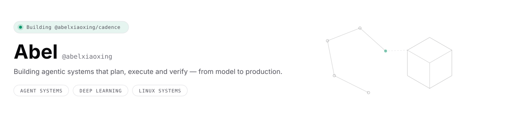
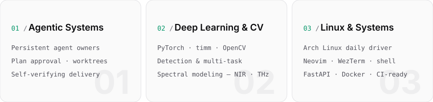
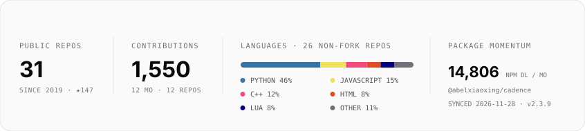
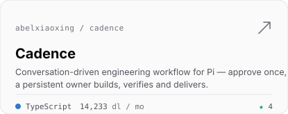
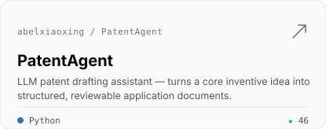
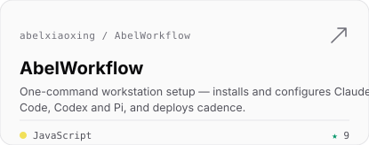
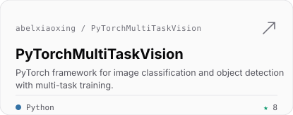
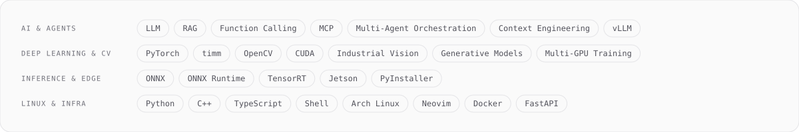

  <picture>
    <source media="(prefers-color-scheme: dark)" srcset="./assets/hero-dark.svg">
    
  </picture>

  <picture>
    <source media="(prefers-color-scheme: dark)" srcset="./assets/focus-dark.svg">
    
  </picture>

 

  <picture>
    <source media="(prefers-color-scheme: dark)" srcset="./assets/telemetry-dark.svg">
    
  </picture>

## Featured Works

  <a href="https://github.com/abelxiaoxing/cadence"><picture><source media="(prefers-color-scheme: dark)" srcset="./assets/card-cadence-dark.svg"></picture></a><a href="https://github.com/abelxiaoxing/PatentAgent"><picture><source media="(prefers-color-scheme: dark)" srcset="./assets/card-patentagent-dark.svg"></picture></a>
  <a href="https://github.com/abelxiaoxing/AbelWorkflow"><picture><source media="(prefers-color-scheme: dark)" srcset="./assets/card-abelworkflow-dark.svg"></picture></a><a href="https://github.com/abelxiaoxing/PyTorchMultiTaskVision"><picture><source media="(prefers-color-scheme: dark)" srcset="./assets/card-pytorchmultitaskvision-dark.svg"></picture></a>

 

  <picture>
    <source media="(prefers-color-scheme: dark)" srcset="./assets/stack-dark.svg">
    
  </picture>

---

  <a href="https://abelxiaoxing.github.io/">Blog</a> · <a href="https://www.zhihu.com/people/luo-tuo-qing-shan-56-17">Zhihu</a> · <a href="https://space.bilibili.com/8303485">Bilibili</a> — Shanghai, China

